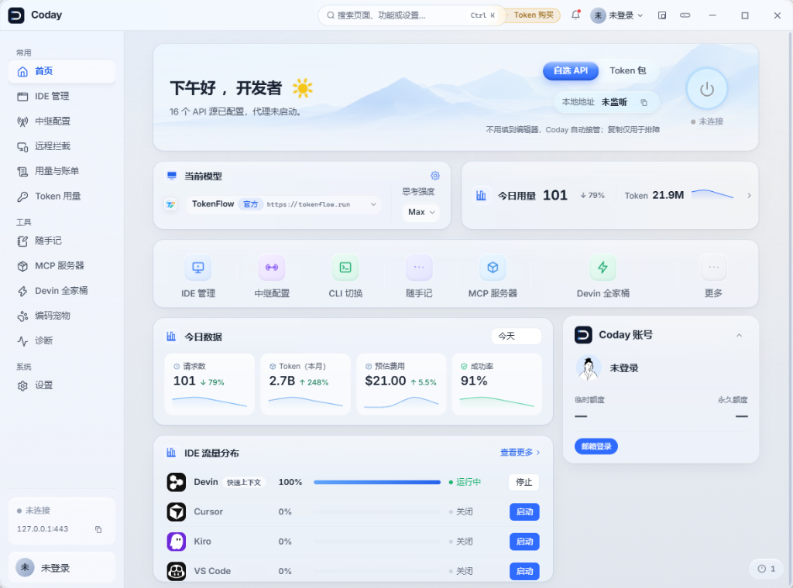
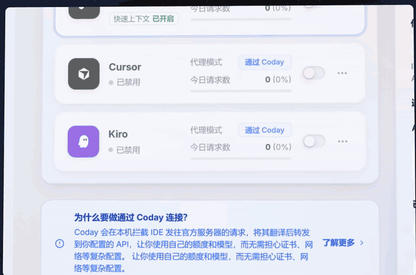
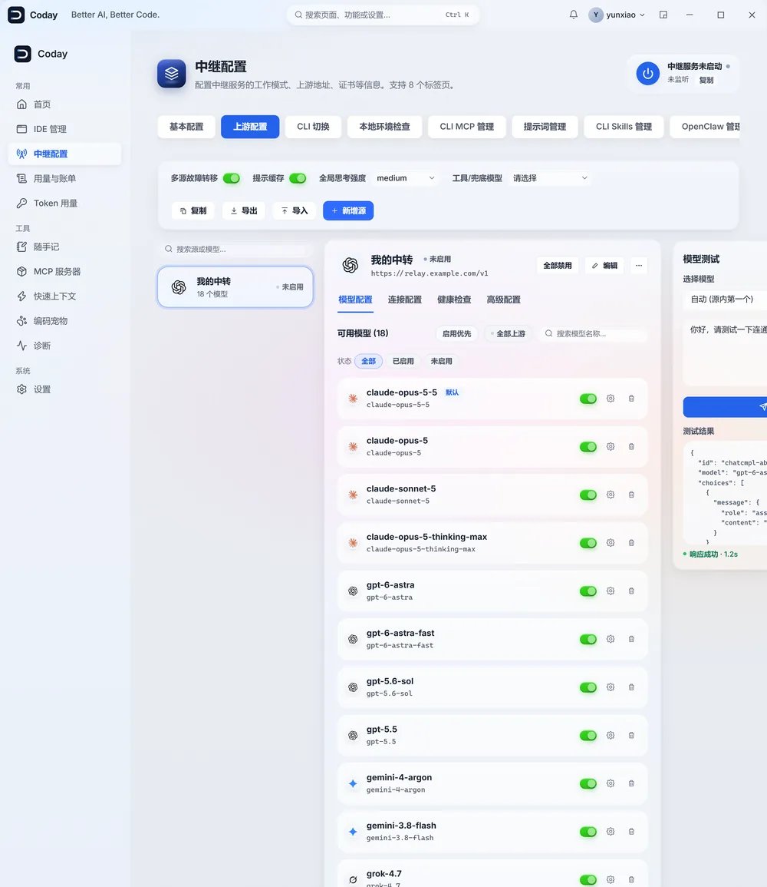
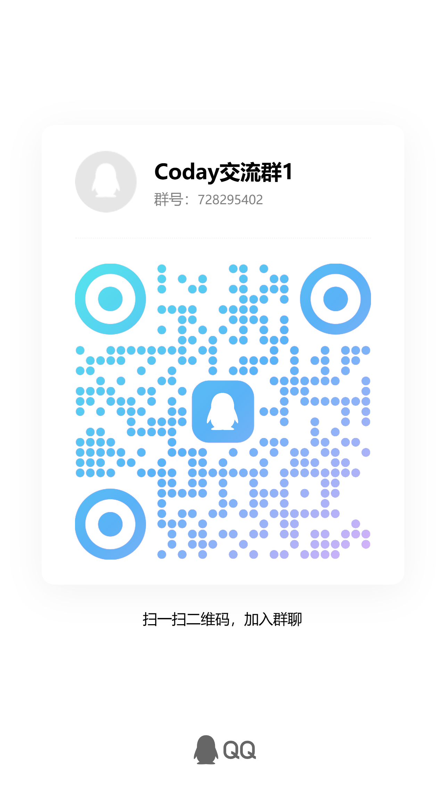

<div align="center">


# Coday

### 不换编辑器，用你自己的模型。

**首推 Devin，同时支持 Cursor / Windsurf / Kiro / VS Code。**
接入任意 OpenAI / Claude 兼容接口，聊天、补全、Agent、工具调用全部照常工作。

[](https://github.com/HyperClockUp/Coday/releases/latest)
[](https://github.com/HyperClockUp/Coday/releases)
[](https://github.com/HyperClockUp/Coday/stargazers)


**[下载最新版](https://github.com/HyperClockUp/Coday/releases/latest)** · [快速开始](#快速开始) · [核心能力](#核心能力) · [常见问题](#常见问题) · [English](./README.en.md)

<br />



</div>

---

## 你是不是也遇到过

- 正在 Devin 里跑任务，额度提示先到了
- 想换个更顺手的模型，编辑器却把模型写死了
- 明明自己有 API Key、有中转站、有公司网关，编辑器偏偏只认它自家的地址
- 三四个编辑器轮着用，每个都要重新配一遍提示词和规则

**Coday 一次解决。** 在本机起一个透明代理，接住编辑器发出的 AI 请求，翻译成你要的协议，转发到你指定的上游。
编辑器那边什么都不用改：照样聊天，照样补全，照样跑 Agent 和工具调用。

```
Devin    ┐
Cursor   ├──>  Coday (本机透明代理)  ──>  OpenAI 兼容 / Claude / 自建服务
Windsurf │      协议转换 / 模型注入 / 多源路由
Kiro     ┘
```

## 为什么值得一试

| | 编辑器自带模型 | 手动改 base_url | **Coday** |
|---|---|---|---|
| 编辑器要改配置 | 不用 | 要 | **不用** |
| 协议转换 | 无 | 自己解决 | **本地自动** |
| 多个源自动切换 | 无 | 无 | **有** |
| 每个编辑器独立人设 | 无 | 无 | **有** |
| 跨编辑器共用项目规则 | 无 | 无 | **有** |
| Remote-SSH 场景 | 受限 | 受限 | **支持 Linux 远端** |
| 请求可见可查 | 无 | 靠抓包 | **内置控制台** |

## 核心能力

### Devin 全家桶（首推）
不只是接管流量，Devin 相关的能力集中在一个面板里：

| 功能 | 做什么 |
|---|---|
| 快速上下文 | 自动复用你本地的 Devin 登录，代码库检索无需额外配置 |
| Devin Tab 补全 | 走官方 GetTab Supercomplete，用你自己的账号凭证 |
| CLI 提示词改写 | 等长改写本机 Devin CLI / Devin Local / ACP 的系统提示词并注入 AGENTS.md，支持一键回滚 |
| Devin 汉化 | 界面文案换成简体中文，语言包等四层落地，可一键还原 |

其余编辑器同样支持接管，见下方。

### 一键接管
点亮开关就能接管 Devin、Cursor、Windsurf、Kiro，以及 VS Code（GitHub Copilot）。自动识别各家协议的差异并转换，聊天、补全、Agent、工具调用全部照常，不用手填 `base_url`。

<p align="center">
  
</p>

### 自选模型与 API 源
粘贴接口地址和 Key，一键同步上游模型列表。显示名、价格标签、自定义模型都能改，支持任意 OpenAI 兼容或 Anthropic 协议接口，随时切换当前源。

<p align="center">
  
</p>

### 多源故障转移
当前源限流、报错或不可达时，自动切到下一个可用源，对话不被打断。默认关闭，按需开启。

### 跨 IDE Skills 感知
自动读取各家编辑器的项目规则文件，换编辑器不丢项目上下文：

`.windsurfrules` · `.cursor/rules/` · `.kiro/steering/` · `CLAUDE.md` · `.devin/`

### 自定义人设
每个编辑器单独设置系统提示词，两种方式：

- **替换**：用你的提示词替换编辑器自带的（工具调用、工作目录等必要内容仍会保留）
- **追加**：在编辑器原有提示词之后追加你的内容

随时可恢复默认。

### 远程开发（Remote-SSH）
编辑器通过 Remote-SSH 连远端时，语言服务和 AI 流量都跑在远端，本地代理够不着。Coday 通过反向 SSH 隧道把流量接回本机，路由和模型注入照常生效。目前支持 Linux 远端。

### 看得见，算得清
内置请求控制台、用量统计、证书与拦截诊断。中继到底通不通、每个请求花了多少，不用猜。

### 还有这些细节
- 图像生成可单独指定出图源
- 全局调节模型思考强度（reasoning effort）
- 按编辑器分别自定义状态栏的账号与额度展示
- 内置 MCP 服务器管理、编码宠物、随手记
- 中英双语界面、深色主题、系统托盘、开机自启、自动检查更新

## 快速开始

1. 从 [Releases](https://github.com/HyperClockUp/Coday/releases/latest) 下载并安装最新版
2. 打开 Coday，选一个内置源，或填入你自己的接口地址与 Key
3. 点击连接，首次运行会自动安装本地 CA 证书并设置拦截
4. 打开 Devin（或 Cursor / Windsurf / Kiro / VS Code），照常使用

装完这一步就结束了，之后编辑器的 AI 请求会自动走你选定的源。

## 常见问题

**我的请求会发到哪里？**
经本机 Coday 代理转换后，发往你在界面里选定的 API 源（内置源，或你自己填写的接口）。对数据流向敏感的话，建议使用你自己的接口地址。

**为什么要安装 CA 证书？**
编辑器的 AI 请求是 HTTPS 加密的，Coday 需要本地 CA 来解密、转换协议后再转发。证书只在本机使用，可在系统证书管理中查看与移除。

**支持哪些模型和接口？**
任意 OpenAI 兼容（Chat Completions / Responses）或 Claude（Anthropic）协议的接口。

**支持 macOS / Linux 吗？**
客户端目前只支持 Windows 10 x64 及以上；远程开发场景支持 Linux 远端主机。

**装完编辑器连不上网怎么办？**
先看内置网络诊断页里的证书与拦截状态；仍无法解决，请加入下方交流群或提 Issue。

## 最近更新

### v0.8.2
- **Devin 一键登录**：内置 OAuth 授权流程，不用再手工复制 session token
- **Devin 官方联网搜索**：直接用账号池里的 Devin 账号，免第三方 Key
- **Fusion 预设**：把两个已有模型配成 Lead + Sidekick，在模型选择器里作为一行 Fusion 出现，两侧可分别设投入与思考等级
- **上游源卡片**：新增「启用/取消启用」「同步」两个按钮，不用再进中栏菜单
- **Devin Local 路径修复**：ACP agent 现在把 Git Bash 放到 `acp.agentEnv.Path` 首位，不再落到 Windows 的 WSL bash launcher（此前 agent 写出的 `E:\` 绝对路径在 WSL 里变成 `/mnt/e/` 而失效），断开连接会一并清掉注入的 Path；诊断面板新增 exec 面 bash 解析结果
- 汉化面板、Stash 云端同步、宠物揭字与液态玻璃规范回归
- Devin 汉化注入、Devin Local 远端与 IDE 安装链路
- 远端拦截多 IDE 统一方案 + IP 漂移校正

修复：
- 中转站模型拉取兼容、分页吸底、模型前缀保存失效
- 发版 changelog 不再复用硬编码旧文案

### v0.8.1
- 窗口圆角与系统实际半径对齐，消除四角缝隙
- 修复加载弧线动画失效
- 界面统一为液态玻璃质感，色彩收敛为品牌蓝加语义色
- 安装包加固，更新 minisign 签名与自动更新清单

### v0.7.18
- 桌宠显示进行中的步骤与计划进度
- 修复 Devin Fast Context Unleash 开关

### v0.7.17
- Fast Context 接入 Devin CLI prompt 改写

### v0.7.16
- 修复 Kiro 文本轮被当成截断而反复重试
- grok-4.x 按模型协议走 OpenAI Chat Completions
- 上游错误在对话中可见

<details>
<summary>更早的版本</summary>

### v0.7.5
- **跨协议 Prompt 缓存**：修复 Devin / Windsurf 多轮对话缓存命中率低的问题，Anthropic、OpenAI Chat Completions、OpenAI Responses 三种协议全部对齐
- **CA 证书序列号匹配**：避免过期同名证书导致 IDE 断连
- 改善中文 Web 搜索结果相关性

完整记录见 [Releases](https://github.com/HyperClockUp/Coday/releases)。

</details>

## Star History

[](https://star-history.com/#HyperClockUp/Coday&Date)

如果 Coday 帮你省下了折腾配置的时间，点一个 **Star** 就是最好的支持，也能让下一个遇到同样问题的人更容易找到它。

## 反馈与交流

使用问题、功能建议或闲聊，欢迎扫码加入 QQ 交流群，也可以直接提 [Issue](https://github.com/HyperClockUp/Coday/issues)。



## 许可

Proprietary. 保留所有权利。
